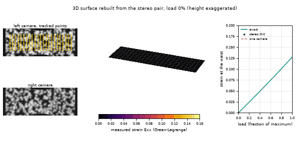
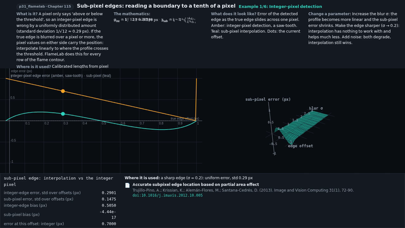
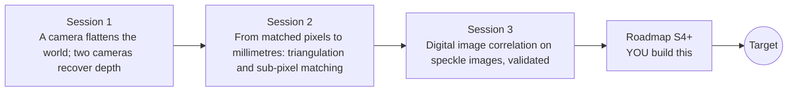

# openstereodic

[](https://github.com/KrunalPanchal1995/openstereodic/actions/workflows/ci.yml)   [](https://colab.research.google.com/github/KrunalPanchal1995/openstereodic/blob/main/sessions/session-01/lesson.ipynb) [](https://krunalpanchal1995.github.io/openstereodic/)

**Measure how a stretched surface deforms in 3D, using only two cameras and random dots.**

openstereodic teaches the mathematics of stereo digital image correlation, from the pinhole camera to sub-pixel matching and strain maps, using only Python and a browser.

- **Start from zero.** Session 1 needs only school geometry (similar triangles); every symbol is explained.
- **See it move.** Every session ships a slider app that runs in the browser, with labelled graphs.
- **Know you got it right.** Images are made by code from a known deformation, so every measurement is graded against the exact answer.
- **Build the missing half.** The repo stops at a flat 2D correlation engine on purpose; the roadmap shows the path to the 3D Target.

[Target](#the-target) · [Who is this for](#who-is-this-for) · [Quick start](#quick-start) · [Sessions](#sessions) · [Roadmap](#roadmap) · [Contribute](#contribute) · [Explainer PDF](docs/explainer.pdf)

> **This repo is incomplete on purpose.** Sessions 1 to 3 are here and fully working. The finished Target below is a preview of what the community can build next. We show you the path, not the code. Sessions 4 and up are yours.

## The Target

A rubber strip with a narrow waist is stretched in 30 steps and photographed by two virtual cameras. From the pictures alone, with no knowledge of the answer, a pipeline rebuilds the 3D surface and colours it by the measured strain. At full load the waist reads 12.4 percent strain against an exact 12.7 percent (RMS error 0.0024 over the surface), while a single camera, fooled by the strip bulging toward it, reports 15.1 percent. Your goal over the coming sessions: understand every ingredient, then build the 3D version yourself.



*Target: a 3D surface rebuilt from two cameras, coloured by measured strain as the strip is stretched*

- [Shear transform: how a matrix deforms a shape, the idea behind strain (video)](promo/media/shear_transform.mp4)

- [Math Visual Studio: reading an edge to a tenth of a pixel (video)](promo/media/subpixel_edge.mp4)



*Sub-pixel edge detection in the Studio*

Try it live:

- [Math Visual Studio: matrices as transformations (Atlas S20)](https://krunalpanchal1995.github.io/studio/#atlas?ch=S20&ex=1)
- [Math Visual Studio: sub-pixel edges (Atlas S115)](https://krunalpanchal1995.github.io/studio/#atlas?ch=S115&ex=1)

How the Target was made is shown only as a path in [promo/roadmap.md](promo/roadmap.md).

## Who is this for
**higher secondary to advanced undergraduate (levels 4-6).** Topic area: Statistics, Research and Experimental Methods.

Prerequisites:

- Similar triangles and a little algebra (school geometry).
- Python 3.10 or newer; if `python --version` works, you are ready. PRIMER.md explains the rest.
- No prior GitHub, image processing or mechanics experience is needed.

New to Python? Read [PRIMER.md](PRIMER.md) first (10 minutes).

## Quick start

No installation knowledge needed. You need [Git](https://git-scm.com/downloads) and [Python 3.10+](https://www.python.org/downloads/) (Windows: tick "Add Python to PATH"). On Mac and Linux type `python3` wherever this page says `python`.

```bash
git clone https://github.com/KrunalPanchal1995/openstereodic.git
cd openstereodic
python start.py 1
```

`start.py` creates a private environment, installs what is needed and runs Session 1 with its checkpoint. Next: `python start.py 2`, `python start.py 3`, or `python start.py test` to check everything. Only a checkpoint: `python start.py check 1`.

Four lines turn the idea of Session 1 into a result (they work as they are): Save it as `try.py` and run it with `python start.py run try.py` (this uses the private environment, where NumPy is installed):

```python
import numpy as np
f, B = 1000.0, 0.04                       # focal length (pixels), distance between the cameras (m)
d = np.array([160.0, 80.0, 40.0, 20.0])   # how far a point jumps between the two pictures (pixels)
print(f * B / d)                          # -> [0.25 0.5  1.   2.  ]  depths in metres: near points jump more
```

Every session also opens in your browser with sliders (no install): [live apps](https://krunalpanchal1995.github.io/openstereodic/). Or use the Colab badge above for the notebook.

## Sessions

| # | Session | Model level | Time | Live app |
|---|---|---|---|---|
| 1 | [A camera flattens the world; two cameras recover depth](sessions/session-01/README.md) | Level 1: conceptual interactive model | 60 min | [open](https://krunalpanchal1995.github.io/openstereodic/session-01/) |
| 2 | [From matched pixels to millimetres: triangulation and sub-pixel matching](sessions/session-02/README.md) | Level 2: mathematical engineering model | 75 min | [open](https://krunalpanchal1995.github.io/openstereodic/session-02/) |
| 3 | [Digital image correlation on speckle images, validated](sessions/session-03/README.md) | Level 3: simulation and validation | 90 min | [open](https://krunalpanchal1995.github.io/openstereodic/session-03/) |

Each session follows the same six steps: A real-world problem, B concept and theory, C visual explanation, D interactive simulation, E worked example and experiment, F assessment and design challenge. Each ends with `checkpoint.py`, which prints `PASS` or `FAIL` against reference numbers. Session 3 also contains the real-world mini-project: **Measure the strain of a stretched rubber strip from two stereo pairs**.

## Architecture



| Folder or file | What is inside |
|---|---|
| `sessions/` | three sessions: README (A-F), `lesson.py`, notebook, live app, exercises, activity sheet, checkpoint |
| `promo/` | the Target: media, live links, and the roadmap (path only) |
| `docs/` | `explainer.tex` and the built `explainer.pdf` |
| `tests/` | runs every lesson and checkpoint headless |
| `start.py` | one command to set up and run anything |
| `QUALITY.md`, `RUBRIC.md` | the quality checklist and the scoring rubric |
| `.github/` | CI, PDF build, Pages deploy, issue and PR templates |

## Roadmap

| Milestone | What you will build | Difficulty |
|---|---|---|
| Session 4: Second-order shape function | A matching function with a quadratic shape function (12 parameters) and a test on a strongly curved field. | intermediate |
| Session 5: Large motion and seed propagation | A tracker that follows a whole grid through displacements far larger than the search window. | intermediate |
| Session 6: Calibrate the stereo rig | A calibration routine and a reprojection-error report. | advanced |
| Session 7: 3D strain on a curved surface | A stereo pipeline that reconstructs a bulging specimen and reports the strain along it. | advanced |
| Session 8: A load history | An animation of the measured strain map over 30 load steps. | advanced |

Full detail with a checkpoint per milestone: [promo/roadmap.md](promo/roadmap.md).

## Contribute
New to GitHub? Read [CONTRIBUTING.md](CONTRIBUTING.md); it starts from zero. Pick an issue labelled `good first issue`. Translations into Hindi, Telugu, Tamil and Malayalam are welcome.

<details>
<summary>Development</summary>

```bash
python start.py test        # runs every lesson and checkpoint
```
Lessons use `# %%` cell markers so they open as notebooks in VS Code. See [QUALITY.md](QUALITY.md) for the standard every session meets.
</details>

## License
MIT. See [LICENSE](LICENSE). Media in `promo/media` is (c) Krunal Panchal, CC BY 4.0.

## Acknowledgments
Part of the [PAN IIT OSS](https://hellofoss.tech-iitb.org/projects) open-source teaching collection, modelled on the structure of [openspline](https://github.com/openspline/openspline). Built on ideas from the Math Visual Studio at https://krunalpanchal1995.github.io/studio/.
