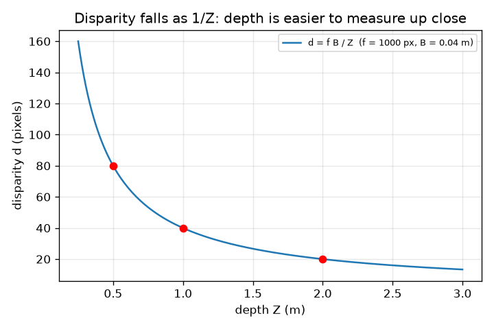
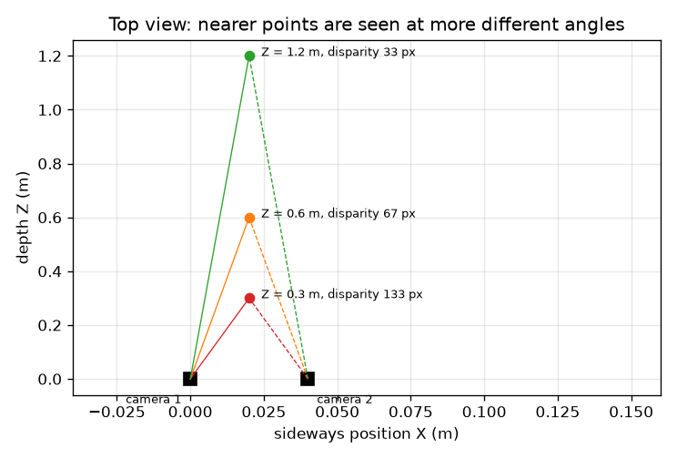

# Session 1: A camera flattens the world; two cameras recover depth

*Level 1 (conceptual interactive model) · about 60 minutes · openstereodic*

> This is a simplified educational model. It is not a validated design tool and must not be used for real structures, electrical installations, vehicles, industrial processes or medical decisions.

**Prerequisites**

- Similar triangles from school geometry.
- You have read PRIMER.md and run `python start.py 1` once.

**Learning objectives.** After this session you can:

- Use the pinhole rule u = f X / Z to find where a 3D point lands in an image.
- Explain why a point seen by two cameras jumps sideways by an amount that depends only on its depth.
- Compute depth from disparity with Z = f B / d, by hand and in Python.
- Explain why far points are measured less precisely than near ones.

## A. Real-world problem
Close one eye, hold a finger at arm's length and switch eyes: the finger jumps against the background, much more than the wall behind it does. A single photograph cannot tell you how far things are, but two photographs taken a few centimetres apart can. Labs use exactly this to measure the shape of a loaded rubber strip without touching it. How is a 3D position found from two flat pictures?

## B. Concept and theory
A pinhole camera lets light from a point (X, Y, Z) pass through a tiny hole and land on a sensor a distance f behind it. By similar triangles the landing place is u = f X / Z sideways and v = f Y / Z upward. We count f in pixels, so u and v are in pixels from the middle of the image. Put camera 2 a distance B (the baseline) to the right of camera 1, both looking straight ahead. For camera 2 the point is B closer to the left, so u2 = f (X - B) / Z. The sideways jump d = u1 - u2 (the disparity) is f B / Z: it contains no X, only the depth Z. Turn it around and Z = f B / d.

| Symbol | Meaning | Unit |
|---|---|---|
| X, Y, Z | position of the point: sideways, up, distance in front of camera 1 | m |
| f | focal length measured in pixels | px |
| B | baseline: distance between the two cameras | m |
| u1, u2 | sideways image coordinate in camera 1 and 2, from the image centre | px |
| d | disparity u1 - u2 | px |

**Assumptions**

- Pinhole cameras with no lens distortion.
- Both cameras look straight ahead, parallel, at the same height, with the same f.
- f and B are known exactly.

$$ u=\frac{fX}{Z},\qquad v=\frac{fY}{Z} $$

$$ u_1=\frac{fX}{Z},\qquad u_2=\frac{f(X-B)}{Z} $$

$$ d=u_1-u_2=\frac{fB}{Z}\quad\Longleftrightarrow\quad Z=\frac{fB}{d} $$

## C. Visual explanation
The first figure is a top view with two cameras 0.04 m apart and three points at depths 0.3, 0.6 and 1.2 m: the rays from the two cameras to a near point make a wide angle (disparity 133 px) and to a far point a narrow one (33 px). The second figure plots disparity against depth for f = 1000 px and B = 0.04 m; the curve falls as 1 / Z, so it is steep up close and nearly flat far away, which is why depth is easy to measure up close and hard far away.

*Disparity against depth: the 1 / Z curve for f = 1000 px and B = 0.04 m.*

*Top view: the nearer the point, the wider the angle between the two rays and the larger the disparity.*

## D. Interactive simulation
Run the lesson (`python start.py 1`), then open the live app: [Session 1: two cameras and one point](https://krunalpanchal1995.github.io/openstereodic/session-01/) (or `app.html` in this folder). Move the depth slider and watch the two rays open and close in the top view; then switch to the graph and see the point slide along the 1 / Z curve. Change the baseline and compare with the grey curve.

**Challenge.** Make the disparity 100 px (within 2 px).

## E. Worked example and experiment
**Problem.** With f = 1000 px and B = 0.04 m, a point sits at X = 0.02 m, Y = 0.01 m, Z = 0.5 m. Where does each camera see it, what is the disparity, and does Z = f B / d give back 0.5 m?

1. Camera 1: u1 = 1000 * 0.02 / 0.5 = 40 px and v = 1000 * 0.01 / 0.5 = 20 px.
2. Camera 2: u2 = 1000 * (0.02 - 0.04) / 0.5 = -40 px (the point is left of its centre line), v = 20 px.
3. Disparity d = u1 - u2 = 40 - (-40) = 80 px. Check with f B / Z = 1000 * 0.04 / 0.5 = 80 px.
4. Depth back from the disparity: Z = f B / d = 1000 * 0.04 / 80 = 0.5 m.

**Answer.** Camera 1 sees (40, 20) px, camera 2 sees (-40, 20) px, the disparity is 80 px and the depth is recovered as 0.5 m.

**Experiment.** Stand 2 m from a wall with a pencil held at 0.5 m. Take two phone photos with the phone moved 4 cm sideways (lay a ruler on a table). Measure the pencil's jump in pixels in an image viewer and compare with f B / Z using your phone's focal length in pixels (about 0.8 to 1.2 times the image width in pixels for a main camera). Expect agreement to about 10 percent: the real lens has distortion, the phone may rotate slightly, and you can only read pixels to about one pixel.

## F. Assessment and design challenge
**Question type A: Conceptual.** Why does the disparity not depend on the sideways position X of the point?

Hint

Write u1 - u2 and see what happens to the terms that contain X.

Step-by-step solution

u1 = f X / Z and u2 = f (X - B) / Z, so u1 - u2 = f X / Z - f X / Z + f B / Z = f B / Z. The X terms cancel. Both cameras see the point shifted sideways by the same amount f X / Z; only the baseline term f B / Z remains, and that depends on the depth.

**Question type B: Numerical.** Two cameras 0.06 m apart with f = 1000 px measure a disparity of 25 px. How far away is the point? Is the answer sensible?

Hint

Z = f B / d. Check the units: px * m / px = m.

Step-by-step solution

Z = 1000 * 0.06 / 25 = 2.4 m. Sanity check: a larger disparity means nearer, and 25 px is smaller than the 60 px we would get at 1 m, so a point beyond 1 m is consistent. Units: px * m / px = m.

**Question type C: Graph and simulation interpretation.** In the graph of disparity against depth, what happens to the disparity when the depth is doubled from 0.5 m to 1.0 m, and what does that mean for the accuracy?

Hint

Read the values at 0.5 m, 1 m and 2 m.

Step-by-step solution

The disparity halves each time the depth doubles: 80 px at 0.5 m, 40 px at 1 m, 20 px at 2 m (the 1 / Z shape). The curve is steeper close up, so one pixel of disparity error corresponds to 6.2 mm of depth at 0.5 m but 95 mm at 2 m. The same matching accuracy gives much worse depth far away.

**Question type D: Design and optimisation challenge.** Design: with f = 1000 px, choose a baseline so that one pixel of disparity corresponds to at most 5 mm of depth at 0.5 m. What is the cost of a longer baseline?

Hint

Use depth step = Z squared / (f B + Z) for a one pixel change, and solve for B.

Step-by-step solution

We need 0.25 / (1000 B + 0.5) <= 0.005, so 1000 B + 0.5 >= 50 and B >= 0.0495 m. A baseline of 0.05 m gives a step of 4.95 mm and a disparity of 100 px at 0.5 m. The cost: with cameras further apart each sees the object from a more different angle, so the two pictures overlap less, matching gets harder (a bigger search range and more perspective change), and the rig is bulkier. Assumption: parallel cameras and exact f.

Score yourself with [RUBRIC.md](../../RUBRIC.md). Print the [activity sheet](activity_sheet.md) to work on paper.

## Common misconceptions
| Common misconception | What is actually true |
|---|---|
| Disparity depends on how far left or right the point is. | Only on its depth Z (d = f B / Z). Sideways position cancels out when you subtract the two images. |
| A bigger disparity means the point is farther away. | The opposite: near points jump more. Z = f B / d, so large d means small Z. |
| Two cameras measure depth equally well at every distance. | A one pixel disparity step is 6 mm at 0.5 m and about 95 mm at 2 m with this rig; accuracy falls as the square of the distance. |

## Glossary
- **pinhole camera**: the simplest camera model: light goes through one point and lands on a sensor
- **focal length (in pixels)**: distance from the pinhole to the sensor, counted in pixel widths
- **baseline**: distance between the two cameras
- **disparity**: how far a point jumps sideways between the two images, in pixels
- **parallax**: the apparent shift of near objects against far ones when you change viewpoint

## Finish
1. Do the three coding tasks in [exercises.md](exercises.md).
2. Run `python start.py 1` again after your changes. It ends with the checkpoint; when it prints `PASS`, you are done. (Checkpoint only: `python start.py check 1`.)

Next: [Session 2](../session-02/README.md)
