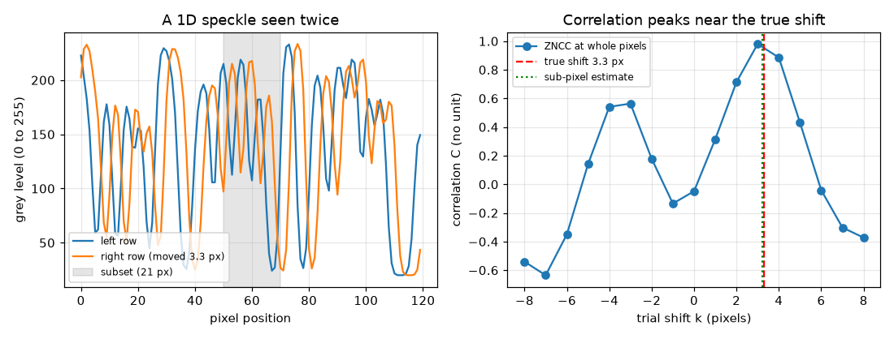
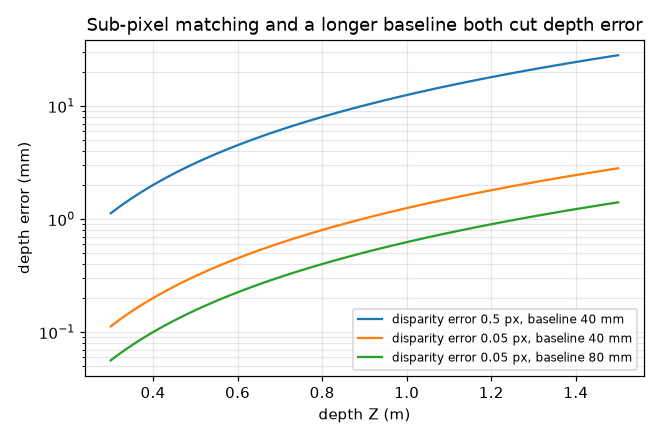
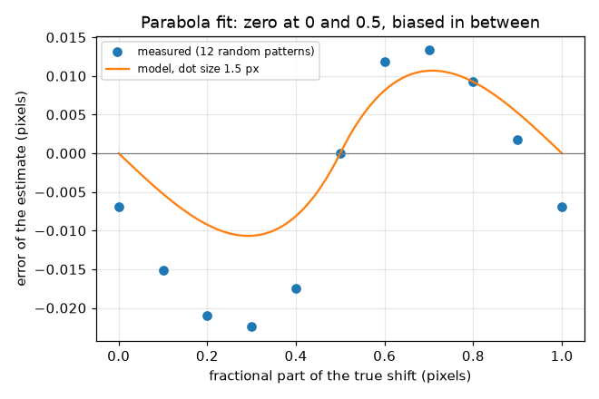

# Session 2: From matched pixels to millimetres: triangulation and sub-pixel matching

*Level 2 (mathematical engineering model) · about 75 minutes · openstereodic*

> This is a simplified educational model. It is not a validated design tool and must not be used for real structures, electrical installations, vehicles, industrial processes or medical decisions.

**Prerequisites**

- Session 1: pinhole camera and Z = f B / d.
- Basic idea of a mean and a correlation (explained in Section B).

**Learning objectives.** After this session you can:

- Triangulate a matched pixel pair into a 3D point with a calibrated camera pair.
- Turn a disparity error into a depth error with dZ = Z^2 dd / (f B).
- Find the match of a small patch by zero-normalised cross-correlation.
- Refine the match to a fraction of a pixel and measure the bias of that refinement.
- Choose a baseline for a required depth accuracy (inverse problem).

## A. Real-world problem
Session 1 said Z = f B / d, but a real camera gives pixels, and the computer must find the matching spot in the second picture by comparing small patches of random dots (speckle). If the match can only be found to a whole pixel, a surface 0.5 m away is located only to about 3 mm, which is useless for seeing a rubber strip stretch. How well can matching be done, and how does a matching error turn into a depth error?

## B. Concept and theory
A calibrated pair means f, B and the principal point (the image centre, CX, CY) are known. A matched pair (uL, vL) in the left image and uR in the right image gives d = uL - uR, Z = f B / d, X = (uL - CX) Z / f and Y = (vL - CY) Z / f. A small error dd in the disparity gives to first order dZ = (Z^2 / (f B)) dd, so depth error grows with the square of the distance and shrinks with a longer baseline. To find the match, take a patch (a subset) of 2h + 1 pixels from the left row and slide it along the right row; at each slide k compute the zero-normalised cross-correlation C(k), which is 1 for a perfect match even if brightness and contrast differ. The best whole-pixel slide k0 is where C peaks. Fitting a parabola through C(k0 - 1), C(k0), C(k0 + 1) gives the sub-pixel peak. The true hill is not exactly a parabola, so the estimate is pulled slightly (pixel locking); for random dots of size sigma the hill is close to exp(-D^2 / (4 sigma^2)), which predicts the bias.

| Symbol | Meaning | Unit |
|---|---|---|
| uL, vL, uR | pixel coordinates of the matched point in the left and right images | px |
| CX, CY | principal point (image centre), 160 and 80 | px |
| dd | error of the measured disparity | px |
| dZ | resulting depth error | m |
| C(k) | zero-normalised cross-correlation at trial shift k | no unit |
| h | subset half-size; the subset is 2h + 1 pixels wide | px |
| sigma | size of one speckle dot (Gaussian standard deviation) | px |

**Assumptions**

- Rectified, parallel cameras: matches lie on the same image row.
- Pattern changes between the two images only by a shift, brightness and contrast.
- Noise is small (Session 3 studies it).
- First-order error propagation (dd much smaller than d).

$$ d=u_L-u_R,\quad Z=\frac{fB}{d},\quad X=\frac{(u_L-C_X)Z}{f},\quad Y=\frac{(v_L-C_Y)Z}{f} $$

$$ \delta Z\approx\frac{fB}{d^{2}}\,\delta d=\frac{Z^{2}}{fB}\,\delta d $$

$$ C(k)=\frac{\sum (f_i-\bar f)(g_{i+k}-\bar g)}{\sqrt{\sum (f_i-\bar f)^2\,\sum (g_{i+k}-\bar g)^2}} $$

$$ k^{*}=k_0+\frac{C(k_0-1)-C(k_0+1)}{2\,\big[C(k_0-1)-2C(k_0)+C(k_0+1)\big]} $$

## C. Visual explanation
The first figure shows a 1D speckle row seen twice, the second moved 3.3 px, and the correlation at whole-pixel slides: it peaks at 3, and the sub-pixel estimate (3.238 for this one pattern) lies between 3 and 4, close to the true 3.3. The second figure shows the error of the parabola estimate against the fractional part of the shift: it is zero at 0 and 0.5 and largest near 0.25 and 0.75 (measured about -0.02 px near 0.3 and +0.01 px near 0.7; the model, with dots of 1.5 px, gives about 0.01 px, the same shape but about half the size). The third figure shows depth error against depth for several settings: whole-pixel matching, sub-pixel matching and a doubled baseline.

*A 1D speckle seen twice (shift 3.3 px) and the correlation of a 21-pixel subset: peak at 3, sub-pixel estimate 3.24.*

*Depth error against depth for whole-pixel matching, sub-pixel matching and a doubled baseline.*

*Error of the parabola estimate against the fractional shift: zero at 0 and 0.5, largest in between.*

## D. Interactive simulation
Run the lesson (`python start.py 2`), then open the live app: [Session 2: sub-pixel matching and depth error](https://krunalpanchal1995.github.io/openstereodic/session-02/) (or `app.html` in this folder). Slide the true shift and watch the parabola's top move; make the dots bigger and see the bias shrink. Then switch to the depth view and change the baseline and the disparity error.

**Challenge.** At Z = 0.5 m or more, get the depth error below 0.2 mm.

## E. Worked example and experiment
**Problem.** With f = 1000 px, B = 0.04 m and principal point (160, 80): a matched pair is uL = 200, vL = 100, uR = 120. Find the 3D point. If the disparity is uncertain by 0.05 px, what is the depth uncertainty?

1. Disparity d = 200 - 120 = 80 px.
2. Z = f B / d = 1000 * 0.04 / 80 = 0.5 m.
3. X = (200 - 160) * 0.5 / 1000 = 0.02 m and Y = (100 - 80) * 0.5 / 1000 = 0.01 m.
4. Depth error dZ = Z^2 dd / (f B) = 0.25 * 0.05 / 40 = 0.0003125 m = 0.3125 mm.
5. For comparison, whole-pixel matching (dd = 0.5 px) gives 3.125 mm.

**Answer.** The point is (0.02, 0.01, 0.5) m; a 0.05 px disparity error gives 0.31 mm of depth error, ten times better than whole-pixel matching.

**Experiment.** Print a random dot pattern, put it on a wall at 0.5 m and shift the phone 4 cm between two photos. Match a patch with `match_subpixel` on one image row and compare with the shift of a known object. Real results are worse than the model: lens distortion, focus blur, noise, and the phone not being perfectly parallel all add error that this idealised model leaves out.

## F. Assessment and design challenge
**Question type A: Conceptual.** Why do we match patches of random dots rather than single pixels, and what goes wrong on a blank patch?

Hint

Think about how many places in the other image look like one pixel, and what correlation does with a constant patch.

Step-by-step solution

A single pixel value looks like thousands of others; a patch of random dots is almost unique, so its correlation peaks sharply at one place. On a blank (constant) patch every pixel equals the mean, the denominator of the correlation is zero and there is nothing to match, which the code reports as correlation 0 instead of guessing. That is why specimens are painted with a random, high-contrast pattern.

**Question type B: Numerical.** At Z = 1.2 m with f = 1000 px and B = 0.04 m, what depth error comes from a disparity error of 0.1 px?

Hint

dZ = Z^2 dd / (f B).

Step-by-step solution

dZ = 1.44 * 0.1 / 40 = 0.0036 m = 3.6 mm. Sanity check: at 0.5 m the same 0.1 px gives 0.625 mm, and 1.2 m is 2.4 times further, so the error should be 2.4^2 = 5.76 times bigger: 0.625 * 5.76 = 3.6 mm.

**Question type C: Graph and simulation interpretation.** In the sub-pixel bias graph, at which fractional shifts is the error zero, and why is it largest in between?

Hint

Look at where the three samples are symmetric around the peak.

Step-by-step solution

The error is zero at 0 and 0.5. At 0 the peak sits exactly on a sample and the neighbours are symmetric; at 0.5 the peak is exactly between two samples, which is again symmetric about the answer. In between the three samples are lopsided and the parabola, which is not the true hill shape, is pulled toward the nearest whole pixel; the measured pull is about 0.01 to 0.02 px near 0.3 and 0.7 (opposite signs).

**Question type D: Design and optimisation challenge.** Design: choose a baseline so that the depth error at 0.5 m is at most 0.2 mm when sub-pixel matching gives dd = 0.05 px. What changes if matching is only good to 0.1 px?

Hint

B = Z^2 dd / (f dZ).

Step-by-step solution

B = 0.25 * 0.05 / (1000 * 0.0002) = 0.0625 m = 62.5 mm. The disparity at 0.5 m is then 125 px, so the search range must be wider and the overlap of the two views smaller. With dd = 0.1 px the baseline doubles to 125 mm, which is hard to build for a small field of view, so improving the matching (better speckle, less noise) is cheaper than moving the cameras apart. Trade-off: baseline versus overlap and matching difficulty.

Score yourself with [RUBRIC.md](../../RUBRIC.md). Print the [activity sheet](activity_sheet.md) to work on paper.

## Common misconceptions
| Common misconception | What is actually true |
|---|---|
| Sub-pixel matching means the cameras have more pixels. | The pixels are the same; the match position is estimated from the shape of the correlation hill using many pixels at once. |
| The parabola fit has no error. | It has a small bias that vanishes at fractional shifts 0 and 0.5 and is largest in between; the random pattern adds scatter of a few hundredths of a pixel. |
| Doubling the distance doubles the depth error. | It quadruples it: dZ = Z^2 dd / (f B). |

## Glossary
- **triangulation**: finding a 3D point from its two image positions and the known cameras
- **calibration**: knowing f, B and the principal point exactly
- **subset**: the small patch of pixels that is matched between images
- **ZNCC**: zero-normalised cross-correlation: similarity of two patches, 1 for identical up to brightness and contrast
- **pixel locking**: bias of the sub-pixel estimate toward whole pixel values

## Finish
1. Do the three coding tasks in [exercises.md](exercises.md).
2. Run `python start.py 2` again after your changes. It ends with the checkpoint; when it prints `PASS`, you are done. (Checkpoint only: `python start.py check 2`.)

Next: [Session 3](../session-03/README.md)
