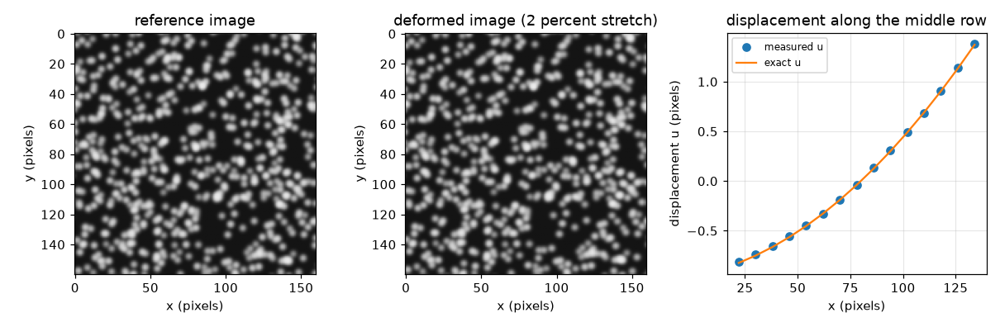
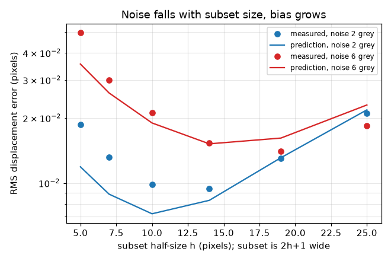

# Session 3: Digital image correlation on speckle images, validated

*Level 3 (simulation and validation) · about 90 minutes · openstereodic*

> This is a simplified educational model. It is not a validated design tool and must not be used for real structures, electrical installations, vehicles, industrial processes or medical decisions.

**Prerequisites**

- Session 1: pinhole camera and parallax.
- Session 2: cross-correlation, sub-pixel matching, depth error.

**Learning objectives.** After this session you can:

- Generate a speckle image of a known deformation and match subsets to sub-pixel accuracy with an affine shape function.
- Turn a displacement field into strain with a least-squares plane fit.
- Validate displacement and strain against the exact values of the synthetic field.
- Predict and measure the effect of image noise and subset size, including a bias-versus-noise trade-off.
- Use the same tools on a stereo pair of a stretched strip (mini-project).

## A. Real-world problem
A rubber strip is painted with random dots and pulled. Two photographs, before and after, are all we have. Where did each patch of dots move, and how much was the rubber stretched? Digital image correlation (DIC) answers both by matching small square subsets between the images. Because we make the images ourselves from a known deformation, we can grade the method: how close does it get, and what limits it?

## B. Concept and theory
The reference image shows a point X at pixel (x, y); after loading the same material point is at x + u(X). DIC finds u by taking a subset of (2h+1) x (2h+1) pixels around (x0, y0) and searching the deformed image for the best match, scored by zero-normalised sum of squared differences. A whole-pixel search gives a start; Gauss-Newton steps refine six numbers: the displacement (u, v) and the four gradients (u,x, u,y, v,x, v,y), which let the subset stretch and shear (an affine shape function). Grey levels between pixels come from cubic convolution interpolation. Strain is the slope of the displacement field, e_xx = du/dx and e_yy = dv/dy (small strain), taken from a least-squares plane fitted to a window of (2w+1)^2 grid points to limit noise. For image noise of sigma_n grey levels in each image and a mean squared image gradient G2, the random displacement error of one subset is sigma_u = sqrt(2) sigma_n / sqrt(N G2) with N = (2h+1)^2. If displacement curves like b x^2, a subset that can only shift and stretch picks up a bias of about b h (h + 1) / 3 pixels, so there is an optimum subset size. The synthetic test uses u = a (x - xc) + b (x - xc)^2 and v = -nu a (y - yc) with a = 0.02, b = 1e-4 per pixel and nu = 0.45.

| Symbol | Meaning | Unit |
|---|---|---|
| u, v | displacement of a subset centre in x and y | px |
| h | subset half-size (the subset is 2h+1 wide) | px |
| a, b | strain and curvature of the test displacement field | no unit, 1/px |
| nu | Poisson ratio (sideways contraction per stretch) | no unit |
| sigma_n | camera noise in each image | grey levels |
| G2 | mean squared image gradient in x | (grey/px)^2 |
| w | strain window half-size in grid points | no unit |
| e_xx, e_yy | strain in x and in y | no unit |

**Assumptions**

- Small strain, plane specimen parallel to the sensor (one camera).
- Noise is independent between pixels and images.
- Brightness and contrast may differ between images (normalised matching handles this).
- The synthetic image is exact (a formula), so any error is the method's, not the renderer's.

$$ u=a(x-x_c)+b(x-x_c)^2,\qquad v=-\nu a(y-y_c) $$

$$ \varepsilon_{xx}=\frac{\partial u}{\partial x}=a+2b(x-x_c),\qquad \varepsilon_{yy}=\frac{\partial v}{\partial y}=-\nu a $$

$$ \sigma_u=\frac{\sqrt{2}\,\sigma_n}{\sqrt{(2h+1)^2\,G_2}} $$

$$ \text{bias}\approx\frac{b\,h(h+1)}{3},\qquad \sigma_\varepsilon=\frac{\sigma_u}{\Delta\,(2w+1)\sqrt{w(w+1)/3}} $$

## C. Visual explanation
The first figure shows the reference speckle image, the deformed image (2 percent stretch) and, on the right, the measured displacement u along the middle row on top of the exact curve: the points lie on the line to within about 0.01 px. The second figure plots the RMS displacement error against subset half-size on a log axis for two noise levels, measured (dots) and predicted (lines): noise dominates for small subsets (error falls as 1 / (2h+1)), bias dominates for large ones (error grows as h^2), so each curve has a minimum, near h = 14 to 19 here.

*Reference and deformed speckle images, and the measured displacement against the exact curve along the middle row.*

*RMS displacement error against subset half-size for two noise levels: measured points and predicted lines (log axis).*

## D. Interactive simulation
Run the lesson (`python start.py 3`), then open the live app: [Session 3: noise, subset size and strain error](https://krunalpanchal1995.github.io/openstereodic/session-03/) (or `app.html` in this folder). Change the camera noise, the curvature of the displacement field, the subset size and the strain window, and watch the displacement error split into a noise term and a bias term. Find the smallest error.

**Challenge.** With noise 6 grey levels and curvature 3e-4 per pixel, keep the total displacement error below 0.03 px and the strain error from noise below 0.0005.

## E. Worked example and experiment
**Problem.** For u = 0.02 (x - 80) + 1e-4 (x - 80)^2 find u at x = 56 and x = 104, the strain at x = 80 from these two points, and the random displacement error for noise 4 grey levels, h = 10 and G2 = 471.

1. u(56) = 0.02 * (-24) + 1e-4 * 576 = -0.48 + 0.0576 = -0.4224 px.
2. u(104) = 0.02 * 24 + 1e-4 * 576 = 0.48 + 0.0576 = 0.5376 px.
3. Strain = (0.5376 - (-0.4224)) / (104 - 56) = 0.96 / 48 = 0.0200. The curvature terms are equal at both points and cancel, so this equals the exact strain a = 0.02 at x = 80.
4. Subset size N = (2 * 10 + 1)^2 = 441 pixels, so sigma_u = sqrt(2) * 4 / sqrt(441 * 471) = 5.657 / 455.8 = 0.0124 px.
5. Measured noise-only error in the code: 0.0118 px, within 5 percent of the prediction.

**Answer.** u(56) = -0.4224 px, u(104) = 0.5376 px, strain 0.0200; the predicted noise error is 0.0124 px.

**Experiment.** Print a speckle pattern on a rubber band, photograph it before and after stretching it by hand against a ruler, and run the same code on the two photos. Measure the strain from the ruler marks (change of length / length) and compare. Real photos add lens distortion, focus blur, lighting changes and out-of-plane motion, none of which are in the synthetic model; expect errors of a few tenths of a percent strain rather than the 0.03 percent seen here.

## Real-world application and mini-project: Measure the strain of a stretched rubber strip from two stereo pairs
A lab photographs a rubber strip before and after loading with two parallel cameras. Both pairs come from `stereo_pair` in Session 3: the unloaded pair is `stereo_pair(strip_dots(), 0.0, 0.0, noise=3.0, seed=10)` and the loaded pair is `stereo_pair(strip_dots(), 0.03, 0.010, noise=3.0, seed=20)`. You are not told what happened to the strip. Use `track_subset` (Session 3) and your own triangulation (Session 2, with the principal point at the image centre (160, 80); the strip appears about 80 px further left in the right image) to find: the depth of the strip before and after, and its strain in x. Then repeat the strain calculation with the left images only, as a single-camera analysis would.

**Deliverable:** A script that tracks a grid of subsets (half-size 11, step 12 pixels) from the unloaded left image into the loaded left image, matches each one into the right image in both states, triangulates to 3D, prints the mean depth before and after, fits the strain in x from the 3D displacements, and prints the single-camera strain next to it.

**Success looks like:** The stereo strain is within 0.003 of the true 0.030 (a reference solution gives 0.0302), the loaded depth is 0.490 m within 2 mm, and the single-camera strain is more than 0.045 (the reference gives 0.052), which shows why one camera is not enough when the specimen also moves toward the lens.

## F. Assessment and design challenge
**Question type A: Conceptual.** Why is the speckle pattern random and high-contrast, and why can the image change brightness without hurting the match?

Hint

Think about uniqueness of a patch, and what subtracting the mean and dividing by the spread does.

Step-by-step solution

A random pattern makes every patch unique, so the correlation has one sharp peak; a regular pattern would match at many places, and a smooth one has no gradient to lock onto (the Gauss-Newton matrix becomes singular, and the code returns NaN for a blank patch). Contrast gives a large image gradient G2, which lowers the noise error as 1 / sqrt(G2). Subtracting each patch's mean and dividing by its spread removes brightness offsets and contrast scaling, so only the pattern's shape is compared.

**Question type B: Numerical.** For noise 6 grey levels, subset half-size h = 14 and G2 = 471, find the random displacement error, and the strain error from noise for a window half-size w = 2 with grid spacing 8 px.

Hint

sigma_u = sqrt(2) sigma_n / sqrt(N G2), N = 29^2; then divide by 8 (2w+1) sqrt(w (w+1) / 3).

Step-by-step solution

N = 841, N * G2 = 396111, sqrt = 629.4. sigma_u = 1.4142 * 6 / 629.4 = 0.0135 px. Strain: 8 * 5 * sqrt(2) = 56.57, so sigma_e = 0.0135 / 56.57 = 0.00024. Sanity check: 0.0135 px over a 40 px baseline is 3e-4, the same order. The real error is about 30 percent bigger because neighbouring subsets overlap.

**Question type C: Graph and simulation interpretation.** In the plot of displacement error against subset size, why does each curve have a minimum, and what moves it?

Hint

Which term dominates for small subsets, and which for large ones?

Step-by-step solution

For small subsets there are few pixels, so noise dominates and the error falls like 1 / (2h+1). For large subsets the subset cannot follow the curved displacement, and the bias b h (h + 1) / 3 grows like h^2. The two cross at the minimum, near h = 14 to 19 for both noise levels in the figure. More noise moves the optimum to larger subsets (the noise curve is higher); more curvature moves it to smaller ones (the bias curve is higher).

**Question type D: Design and optimisation challenge.** Design: with noise 6 grey levels and G2 = 471, choose the smallest strain window (w = 1, 2 or 3, grid spacing 8 px, h = 14) so the strain error from noise stays below 0.001. What do you lose with a larger window?

Hint

Use sigma_e = sigma_u / (8 (2w+1) sqrt(w (w+1) / 3)) with sigma_u = 0.0135 px.

Step-by-step solution

w = 1: 8 * 3 * sqrt(2/3) = 19.6, so sigma_e = 0.0135 / 19.6 = 0.00069 (below 0.001; allowing 30 percent extra for overlap gives about 0.0009, still passing, but with little margin). w = 2 gives 0.00024 with a lot of margin. Choose w = 1 for the best spatial resolution (the window spans 2 * 8 + 29 = 45 px) or w = 2 for safety (61 px). The cost of a bigger window is spatial resolution: a sharp strain peak (such as a neck) is smoothed and its height underestimated.

Score yourself with [RUBRIC.md](../../RUBRIC.md). Print the [activity sheet](activity_sheet.md) to work on paper.

## Common misconceptions
| Common misconception | What is actually true |
|---|---|
| A bigger subset is always better. | It averages more noise, but a curved displacement makes a pure-shift or affine subset biased, so there is an optimum. |
| Strain is the difference of two neighbouring displacements. | That amplifies noise. A least-squares slope over several points is far less noisy. |
| A 2D (one-camera) DIC result is the true surface strain. | It is only the strain of the image. If the specimen moves toward the camera the image magnifies and the apparent strain is wrong; the mini-project shows 0.052 against a true 0.030. |

## Glossary
- **DIC**: digital image correlation: measuring displacement by matching patches between images
- **subset**: the square patch of pixels around a point that is matched
- **shape function**: the model of how the subset deforms; here shift plus stretch and shear (affine)
- **interpolation**: estimating grey levels between pixels, here by cubic convolution
- **strain window**: the group of grid points used for the least-squares slope
- **Poisson ratio**: sideways shrinkage divided by stretch; about 0.45 to 0.5 for rubber

## Finish
1. Do the three coding tasks in [exercises.md](exercises.md).
2. Run `python start.py 3` again after your changes. It ends with the checkpoint; when it prints `PASS`, you are done. (Checkpoint only: `python start.py check 3`.)

Next: the [roadmap](../../promo/roadmap.md). Session 4 is yours to build.
